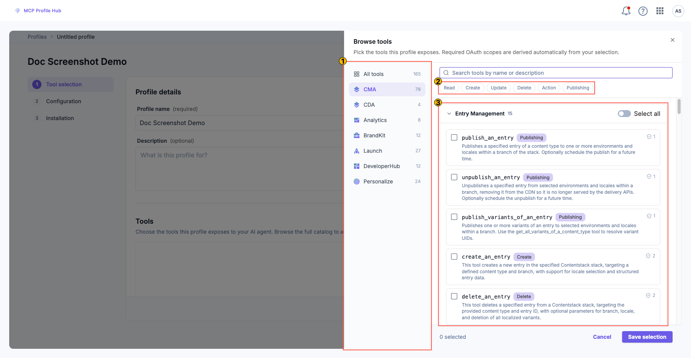
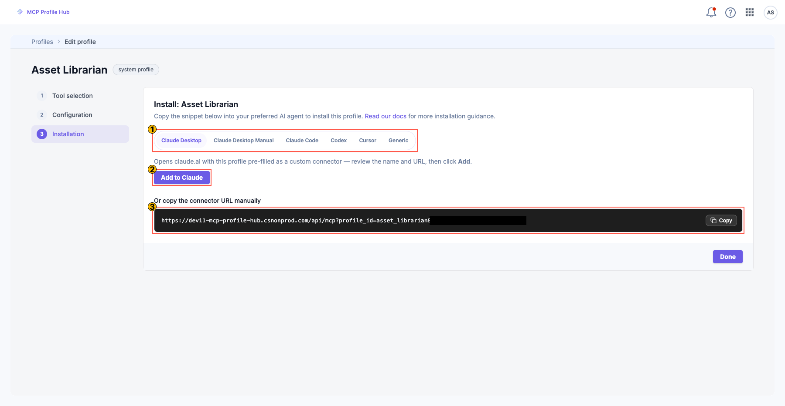
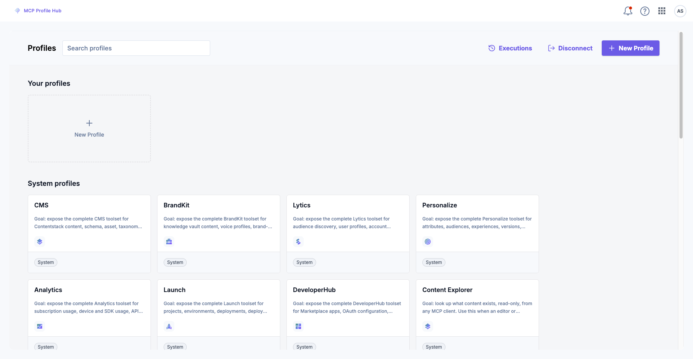

---

## uid: ""

url: "/agent-os/mcp-profile-hub"
seo_title: "MCP Profile Hub | Contentstack"
seo_description: "Create governed MCP profiles that expose a curated set of Contentstack tools, then connect them to Claude, ChatGPT, Cursor, and other AI clients."

# MCP Profile Hub

MCP Profile Hub is a Contentstack Marketplace app that creates **profiles**: each profile exposes a fixed, named subset of Contentstack tools over the Model Context Protocol (MCP), and any MCP-compatible AI client can connect to it. Without that scoping, an agent given all the Contentstack tools at once picks the wrong tool more often, fills its context window with unused tool definitions, and fails tasks that smaller models could otherwise complete.

## What you'll learn

- Decide whether to install a ready-made system profile or build a custom one
- Create a profile using the Tool selection, Configuration, and Installation wizard
- Connect a profile to Claude, Claude Code, Cursor, Codex, ChatGPT, or another MCP client
- Verify a connected client can call the profile's tools
- Diagnose a failed connection or a failed tool call


## Quick decision guide


| Approach               | Key configuration value                                            | Reason                                                                                               |
| ---------------------- | ------------------------------------------------------------------ | ---------------------------------------------------------------------------------------------------- |
| Use a system profile   | Pick a profile from the System profiles list, then choose a stack  | Fastest path. No tool selection needed, works for common jobs like asset lookup or content discovery |
| Build a custom profile | Run the 3-step wizard: Tool selection, Configuration, Installation | Needed when no system profile matches the job, or the job requires a specific, narrower toolset      |


## Prerequisites

Mandatory:

- Access to the [MCP Profile Hub Marketplace app](https://www.contentstack.com/marketplace) in your Contentstack organization
- At least one Contentstack stack for the profile to operate on
- A clear idea of the one job the profile should support

Optional:

- Familiarity with the [Model Context Protocol](https://modelcontextprotocol.io/), if you have not connected an MCP server to an AI client before


## Create a profile

You build a profile in the MCP Profile Hub app using a three-step wizard: Tool selection, Configuration, Installation. You can also start from a ready-made system profile and only configure and install it.

### Option A: use a system profile

1. On the **Profiles** screen, open a profile from the **System profiles** section, for example *Asset Librarian* or *Content Explorer*.
2. Complete **Configuration**: pick the stack the profile operates on.
3. Continue to **Installation**.

No tool selection is needed for a system profile.

### Option B: build a custom profile

**Step 1: Select tools**

1. Click **New Profile**.
2. Give the profile a **name** (required) and an optional **description** of the job it supports.
3. Under **Tools**, click **Browse catalog**.
4. Pick a catalog on the left, for example CMA (Content Management API), CDA (Content Delivery API), or Launch, then search or filter within it. Tools are grouped by area and tagged by operation: Read, Create, Update, Delete, Action, or Publishing.
5. Select the tools this profile should expose and click **Save selection**.
6. Click **Save & Continue**.



A wider tool selection pulls in more OAuth (Open Authorization) scopes for the client to request, since required scopes are derived automatically from your selection. Keep the selection tight. Prefer a second focused profile over piling unrelated tools into one.

**Step 2: Configure**

1. Under **Configuration**, connect the Contentstack project the profile operates on.
2. Select the **Stack** (required).
3. Click **Save & Continue**.

**Step 3: Install**

The profile is now published with a hosted endpoint:

```
https://mcp-hub.contentstack.com/api/mcp?profile_id=<profile_id>
```

The `profile_id` is a catalog identifier, not a secret. Identity is established entirely through OAuth, so the URL is safe to share.

The **Install** screen shows a ready-to-paste snippet for each supported client, plus the raw connector URL.



Pick your client and follow the matching section under [Connect your AI client](#connect-your-ai-client).

Verification: the profile's Installation screen shows a stable endpoint URL. That URL is what you paste into an MCP client in the next section.

### Edit a profile

Reopen a profile any time to change its tools or configuration. The `profile_id` and connector URL stay stable, so connected clients keep working after you edit it.

## Connect your AI client

Every profile is a remote MCP server you connect to over Streamable HTTP. Auth is handled by OAuth in the browser on first connect. No keys, management tokens, or delivery tokens go into client configuration.

The steps below use the `asset_librarian` profile as an example. Swap in your own `profile_id`, or copy the ready-made snippet from the profile's Installation step.

```
https://mcp-hub.contentstack.com/api/mcp?profile_id=asset_librarian
```


### Claude (Desktop and web)

1. From the profile's Installation step, open the **Claude Desktop** tab and click **Add to Claude**. This opens claude.ai's *Add custom connector* dialog, pre-filled.
2. Review the details and click **Add**.

TODO(screenshot): Add custom connector dialog. It should show the pre-filled connector name and URL, and the Add button.

To add it by hand instead:

1. Open **Settings → Connectors → Add custom connector** on claude.ai.
2. Set a name (for example, `Asset Librarian`).
3. Paste the connector URL and click **Add**.
4. Complete the browser OAuth sign-in when prompted.

Alternatively, configure the Claude Desktop app through `claude_desktop_config.json` using the `mcp-remote` bridge, which proxies the remote server over stdio and handles the OAuth flow. This requires Node.js.

```json
{
  "mcpServers": {
    "asset-librarian": {
      "command": "npx",
      "args": [
        "-y",
        "mcp-remote",
        "https://mcp-hub.contentstack.com/api/mcp?profile_id=asset_librarian"
      ]
    }
  }
}
```

1. Claude Desktop only reads `claude_desktop_config.json` on launch, so restart it to pick up the new server entry.
2. On first use, a browser opens for Contentstack OAuth. Approve the scopes.

Verification: the profile's tools appear in Claude's tool list once OAuth completes.

### Claude Code (CLI)

Claude Code supports remote HTTP MCP servers natively.

1. Run:

```bash
claude mcp add --transport http asset-librarian "https://mcp-hub.contentstack.com/api/mcp?profile_id=asset_librarian"
```

An unquoted URL lets the shell interpret `?` and `&` as shell syntax instead of part of the URL, breaking the command. Keep the URL quoted. To make the server available in every project, add `--scope user`.

1. Run `/mcp` inside Claude Code and pick the server.
2. Complete the browser sign-in.

Verification: `/mcp` lists the server as connected, with the profile's tools available.

### Cursor

1. Add the server under `mcpServers` in `.cursor/mcp.json` (project-level) or your global Cursor MCP configuration:

```json
{
  "mcpServers": {
    "asset-librarian": {
      "type": "http",
      "url": "https://mcp-hub.contentstack.com/api/mcp?profile_id=asset_librarian"
    }
  }
}
```

1. Open **Cursor Settings → MCP** (or reload).
2. On first tool use, approve the Contentstack OAuth prompt in the browser that opens.

Verification: the server shows as connected under **Cursor Settings → MCP**, with the profile's tools listed.

### Codex and ChatGPT

**OpenAI Codex CLI**

1. Add this block to `~/.codex/config.toml`:

```toml
[mcp_servers.asset-librarian]
url = "https://mcp-hub.contentstack.com/api/mcp?profile_id=asset_librarian"
```

Add one `[mcp_servers.<name>]` block per profile.

1. On first use of a tool, approve the browser OAuth flow Codex runs.

**ChatGPT**

ChatGPT connects to remote MCP servers as custom connectors. The exact menu names depend on your plan, so consult OpenAI's current connector documentation if these steps do not match what you see.

1. In ChatGPT, open **Settings → Connectors**.
2. Choose **Add custom connector**, give it a name, and paste the connector URL.
3. Save, then complete the Contentstack OAuth sign-in and approve the scopes.
4. Enable the connector in a conversation.

Verification: ask the agent to do something the profile supports, for example:

> List the assets in my stack.


### Other MCP clients

Any MCP-compatible client can connect. Point it at the profile URL as a remote HTTP MCP server. Auth endpoints are discovered automatically. Do not add bearer tokens or API keys.

For clients that only support stdio, bridge with [mcp-remote](https://www.npmjs.com/package/mcp-remote) (requires Node.js), using the same configuration shape shown for Claude Desktop above.

Verification: most clients list the connected server and its tools once auth completes. Ask the agent to do something the profile supports. If tools do not appear or the call fails, see [Troubleshooting](#troubleshooting).

## Theory sections


### How MCP Profile Hub works

MCP Profile Hub has three parts:

1. **Profiles**: the scoped tool bundles you create and publish in the MCP Profile Hub app.
2. **The hosted runtime** at `mcp-hub.contentstack.com`: loads the profile, authenticates the user, applies stack context, enforces permissions, and executes operations.
3. **MCP clients**: any MCP-compatible app (Claude, ChatGPT, Cursor, VS Code, Claude Code, Codex, and others) that connects to a profile's endpoint.

The request lifecycle:

1. You create a profile in the MCP Profile Hub app: pick tools, configure a stack, publish. You get a profile URL.
2. You add the profile URL to your MCP client. The client opens a browser for Contentstack OAuth, you sign in and approve the requested scopes.
3. When the client calls a tool, the runtime validates your token, resolves the target stack, applies context, checks your permissions, executes the operation, and logs the result.

A profile bundles:

- **Identity**: a name, description, and unique `profile_id` (for example, `asset_librarian`)
- **Tools**: the curated set of catalog tools it exposes
- **Configuration**: the Contentstack projects it operates on, such as the default stack
- **Scope**: private to you, or shared across your organization

Tools are not raw API endpoints. When a client connects, the runtime contextualizes each tool against your actual Contentstack setup, so the tool reflects what you can actually do rather than a generic API surface.

### System profiles and custom profiles

**System profiles** are curated, ready-to-use profiles available to every organization, such as *Asset Librarian*, *Content Explorer*, *Content Modeler*, *Campaign Go-Live*, and *Broken Reference Checker*. Most are deliberately narrow: read-only discovery or a single focused operation. Product-level profiles (for example, a full-CMS profile) are the exception. They expose an entire product catalog, including destructive tools, and should only be used when full product control is intended.

**Custom profiles** are created by your organization. You build them from the tool catalog to match your own jobs, for example a regional publishing assistant, a localization workflow profile, or a content audit profile.



A profile works best when it supports one well-defined job. When in doubt:

- Prefer a new focused profile over broadening an existing one.
- Expose only the tools the job needs.
- Reserve broad profiles with destructive tools for admins who need full product control.


### Tools and catalogs

A profile's tools are drawn from catalogs, one per Contentstack service:


| Catalog               | Covers                                                                                                          |
| --------------------- | --------------------------------------------------------------------------------------------------------------- |
| CMA                   | Content Management API: entries, assets, content types, branches, workflows, releases, environments, publishing |
| CDA                   | Content Delivery API: read-only published content                                                               |
| Analytics             | Content and API usage analytics                                                                                 |
| Brand Kit             | On-brand content generation                                                                                     |
| Launch                | Deployments, environments, CDN cache revalidation, logs                                                         |
| Developer Hub         | Marketplace apps, OAuth, and app-integration management                                                         |
| Audience Intelligence | Audience segments, user profiles, and behavioral intelligence (Lytics)                                          |
| Personalize           | Experiences, experiments, and personalization data                                                              |


More tool categories will be added over time. Browse the catalog in the app for the current tool set.

### Who it's for

- Content editors who want to look things up or run approved operations without opening the CMS
- Developers who want contextual Contentstack helpers in an IDE or terminal
- Operations teams that run repeatable content and campaign workflows
- Admins who need to expose safe, narrow capabilities to non-technical users


### MCP Profile Hub vs the Contentstack MCP Server

Both connect AI agents to Contentstack and cover the same kinds of work. They differ in how you install them and how many tools your agent ends up with:


|                | [Contentstack MCP Server](https://www.contentstack.com/docs/agent-os/contentstack-mcp-server)             | MCP Profile Hub                                                                    |
| -------------- | --------------------------------------------------------------------------------------------------------- | ---------------------------------------------------------------------------------- |
| Installation   | Runs locally via `npx`, configured per machine with credentials or an OAuth session                       | Hosted at `mcp-hub.contentstack.com`. Nothing to install, add a URL to your client |
| Transport      | stdio, so it only works in clients that can run a local process                                           | Streamable HTTP, so it also works in web-based clients like claude.ai and ChatGPT  |
| Tool selection | Tool groups (`cma`, `launch`, and so on). Each group loads its full toolset, up to 77 tools for CMA alone | Curated per profile. You expose exactly the tools a job needs, nothing more        |


In short: the MCP Server gives a developer the full toolset on their own machine, MCP Profile Hub gives anyone a scoped toolset from any client, shareable across a team.

### Authentication and permissions

MCP Profile Hub uses standard OAuth. There are no API keys to paste, share, or rotate.

How a client authenticates:

1. The client connects to the profile endpoint.
2. It discovers the auth endpoints automatically and runs the OAuth 2.1 with PKCE (Proof Key for Code Exchange) flow, using Dynamic Client Registration. There is no client ID or secret to configure by hand.
3. A browser opens, you sign in to Contentstack and approve the requested scopes.
4. The client receives a short-lived token and caches it locally, refreshing it as needed.

The OAuth scopes a profile requests are derived automatically from the tools it exposes. A read-only profile requests only read scopes, selecting a publishing tool pulls in the scope needed to publish. You approve the concrete scope set in the browser at connect time.

Least-privilege execution: access is derived from your existing Contentstack roles.

- You can only perform operations your account already allows.
- A profile can narrow what's available, but never grant more than you have.
- If a tool call exceeds your permissions, it fails. The profile is a gate, never an escalation path.

Frequently asked:


| Question                                        | Answer                                                      |
| ----------------------------------------------- | ----------------------------------------------------------- |
| Do I need to create an API key?                 | No. Auth is OAuth, you sign in through the browser.         |
| Is the connector URL sensitive?                 | No. The `profile_id` is a catalog identifier, not a secret. |
| Can a shared profile give someone extra access? | No. Each user connects with their own login and roles.      |
| Where are tokens stored?                        | Cached locally by your MCP client, they are short-lived.    |


### Audit logging

All profile activity is logged. A log entry captures the user, profile, client, tool, timestamp, input payload, execution result, and permission outcome. Audit history is scoped per organization and per user, so each user sees their own activity.

The MCP Profile Hub app includes an **Executions** view: a searchable, filterable history of tool calls across your profiles. Each entry shows the status (running, completed, or failed), the profile and tool involved, timing, any error message, and expandable request metadata.

TODO(screenshot): Executions view. It should show a filterable list of tool calls with status badges, profile and tool names, timestamps, and one expanded row with request metadata or an error message.

Use it to:

- Confirm a client's tool calls are succeeding.
- Diagnose a failed call from its error message and metadata.
- Review what a shared profile is being used for across the team.


## Troubleshooting

Start with the **Executions** view in the MCP Profile Hub app. Most execution failures show a clear error message and request metadata there.

### Connection issues


| Symptom                              | Root cause                                      | Resolution                                                                                                                        |
| ------------------------------------ | ----------------------------------------------- | --------------------------------------------------------------------------------------------------------------------------------- |
| Client shows the server but no tools | OAuth was not completed                         | Trigger the sign-in (for example, `/mcp` in Claude Code) and finish the browser flow.                                             |
| Browser never opens for sign-in      | Client cannot reach the auth discovery endpoint | Confirm the URL is exactly `https://mcp-hub.contentstack.com/api/mcp?profile_id=<id>`.                                            |
| `mcp-remote` fails to start          | Node.js is missing, or `npx` is blocked         | Install Node.js, ensure `npx -y mcp-remote` can run.                                                                              |
| Auth loops or repeated sign-in       | Stale cached token                              | Clear the client's cached MCP credentials and reconnect. For `mcp-remote`, remove its local auth cache (`~/.mcp-auth`) and retry. |


### Authentication errors

- **Sign-in required or not authorized**: root cause is that you have not completed OAuth for this profile, or the token expired and could not refresh. Resolution: reconnect and sign in again.
- **Scope not granted**: root cause is that the profile requests scopes you did not approve. Resolution: reconnect and approve all requested scopes, or ask the profile owner to narrow the tools.


### Execution errors


| Error                       | Root cause                                              | Resolution                                                                                                                |
| --------------------------- | ------------------------------------------------------- | ------------------------------------------------------------------------------------------------------------------------- |
| Permission denied on a tool | Your Contentstack role cannot perform the operation     | This is least-privilege working as intended. Use an account with the needed role, or a profile scoped to what you can do. |
| No stack selected           | The profile has no stack configured and none was passed | Configure a stack in the profile's Configuration step, or pass the stack in the tool arguments.                           |
| Cannot find that stack      | Wrong stack or region mismatch                          | Confirm the profile's configured stack is correct for your account and region.                                            |
| Tool not found              | Tool name mismatch in the client                        | Use the exact tool name the client lists for the server.                                                                  |


### Still stuck

- Reopen the profile and re-check Tool selection and Configuration.
- Confirm you can perform the same action in the Contentstack UI with your account. MCP Profile Hub never grants more than your roles allow.
- Check the Executions log for the failing call's metadata.


## Next steps

- [Contentstack MCP Server](https://www.contentstack.com/docs/agent-os/contentstack-mcp-server): compare the locally-installed MCP Server against MCP Profile Hub if you need the full toolset on a developer machine instead of a scoped, hosted profile.
- [MCP Client: Connect Remote Tools](https://www.contentstack.com/docs/agent-os/mcp-client-connect-remote-tools): connect any remote MCP server, including but not limited to MCP Profile Hub, to the Contentstack Agent.
- [Model Context Protocol](https://modelcontextprotocol.io/): read the open specification MCP Profile Hub implements, if you want to understand the protocol beyond this doc's scope.

