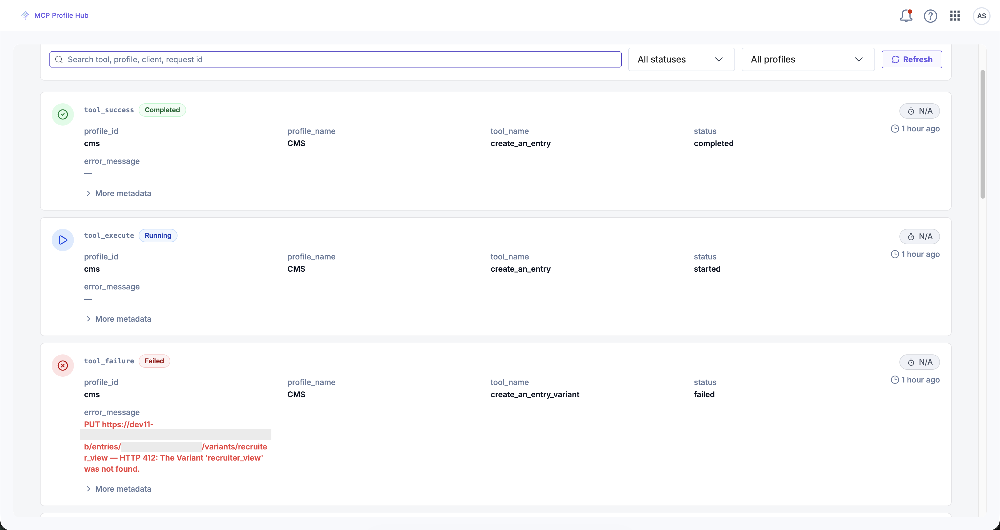

# Monitor and troubleshoot

## Overview

Review the tool calls a profile runs, and diagnose failures from their error messages. The **Executions** view records each tool call with its status, client, and error message, so you can confirm that calls reach Contentstack. When a client cannot connect, lists no tools, or reports a failed tool call, find the error message in [Troubleshooting](#troubleshooting).

## The Executions view

Open **Executions** from the Profiles screen. Each entry shows:

| Field | Holds |
| --- | --- |
| Status | **Completed**, **Running**, or **Failed** |
| Client | The MCP client that made the call, for example `claude-code 2.1.4` |
| `profile_id` and `profile_name` | The profile the call ran against |
| `tool_name` | The tool the agent called |
| `error_message` | The failure text, when the call failed |
| Duration | How long the call took |
| Timestamp | How long ago the call ran |

Expand **More metadata** on an entry to see the rest, including the input parameters the app captured on the running event.



### Page further back through the history

The view loads 50 executions at a time, and the filters narrow only what it has already loaded. To reach older executions, follow the three steps below:

1. Clear the filters.
2. Click **Load more**.
3. Filter again.

> **Additional Resource:** For more information on why the filters and **Load more** behave this way, refer to the [Limitations](#limitations) section.

## Troubleshooting

The groups below sort failures by their source: the connection and sign-in, your local environment, authentication, configuration, automations and agents, and tool selection.

**Not every failure comes from the profile.** A tool call can fail because the model passed incomplete or malformed arguments, for example omitting a required field on publish. Some MCP clients retry the call with corrected arguments. The MCP client and the model control this retry behavior, not the profile or the tool. See [The agent calls the wrong tool, or passes invalid arguments](#the-agent-calls-the-wrong-tool-or-passes-invalid-arguments) for the fix.

### Connection and sign-in problems

Every group under Troubleshooting sorts its entries by the symptom you see first. A sign-in cause such as an incomplete Open Authorization (OAuth) flow can therefore appear under connection problems even though it also relates to authentication.

#### The client shows the server but no tools

**Root Causes**

- You did not finish OAuth.
- Contentstack disabled the profile. A disabled profile returns an empty tool list.

**Resolution**

1. Start sign-in again from your client, for example with `/mcp` in Claude Code, and complete the browser flow.
2. If sign-in completed and the client still lists no tools, Contentstack [disabled the profile](/developers/mcp-profile-hub-manage-profiles#enable-and-disable-a-profile). The app provides no control for this setting, and you cannot change it yourself, so contact [Contentstack support](mailto:support@contentstack.com).

#### No tools appear, and the connection reports an error

**Root Cause**: A malformed project UID in the connector URL fails the whole tool listing, not only the affected product.

**Resolution**: Correct the project UID in the [connector URL](/developers/mcp-profile-hub-url-parameters). The URL parameters reference gives the accepted format for each parameter.

#### The browser never opens for sign-in, and the URL looks wrong

**Root Cause**: You mistyped the connector URL.

**Resolution**: Confirm the URL matches the one on the Installation step, including `profile_id` and `org_uid`.

#### The browser never opens for sign-in, and the URL is correct

**Root Cause**: The client cannot reach the discovery endpoint.

**Resolution**

1. Confirm the machine can reach the endpoint over HTTPS, for example by opening the connector URL directly in a browser.
2. Check for a corporate proxy, VPN, firewall, or TLS-inspecting middlebox blocking the request.

#### The client asks you to authorize repeatedly

**Root Cause**: Contentstack raised the pinned `mcp-remote` version, and the new version stores credentials in a new, empty directory.

**Resolution**: Sign in again. A [version change](/developers/mcp-profile-hub-connect-a-client-to-profile-hub#why-contentstack-pins-the-mcp-remote-version) triggers this prompt and does not indicate a fault.

#### Sign-in loops with no version change

**Root Cause**: The client has a stale cached token.

**Resolution**: Clear the client's cached MCP credentials and reconnect. For `mcp-remote`, delete the version-specific subdirectory under `~/.mcp-auth` and retry. In Claude Code, use `/mcp` to sign in again.

> **Warning:** `~/.mcp-auth` holds cached OAuth credentials for every MCP server you have connected through `mcp-remote`, not only Contentstack. Deleting the whole directory signs you out of all of them, and each one prompts for authorization again on next use.

### Local environment

#### mcp-remote fails to start, and Node.js is missing

**Root Cause**: You have not installed Node.js on the machine.

**Resolution**: Install Node.js and confirm `npx -y mcp-remote` runs.

#### mcp-remote fails to start, and Node.js is installed

**Root Cause**: A registry allowlist, execution policy, or proxy blocks `npx` from reaching the npm registry.

**Resolution**: Install `mcp-remote` globally from an approved registry and configure the client to run the installed binary instead of `npx`, or ask IT to allowlist the package.

### Authentication and permission errors

Contentstack returns an authentication or permission failure to the client as JSON-RPC error code `-32010` with the message `authorization_required`. The accompanying `reason` field identifies which of the three cases below applies, so check it before you choose a resolution.

In all three cases, a profile grants no more access than your Contentstack roles allow. If a call fails on permissions, sign in to Contentstack as the same user and try the same action in the UI. If the action also fails in the UI, your role does not permit it.

#### authorization_required, with reason no_token or local_token_unavailable

**Root Cause**: You have not completed OAuth for this profile, or the stored token expired.

**Resolution**: Reconnect and [sign in again](/developers/mcp-profile-hub-connect-a-client-to-profile-hub#authentication-and-permissions). The error also includes an `authorization_url` you can open directly.

#### authorization_required, with reason insufficient_scope

**Root Cause**: Contentstack returned `403`. Either the token lacks a required OAuth scope, or your Contentstack role does not permit the operation. The message below includes the method and path:

```text
Permission denied for <METHOD> <PATH>. The authorized token may lack a required
OAuth scope, or your Contentstack role may not permit this operation. If scopes
were recently changed, re-authorize from the Authorization page (add the needed
scope to the curated list) and try again.
```

**Resolution**

1. Reconnect and approve the requested scopes, adding the needed scope to the curated list on the Authorization page.
2. If you already granted the scope, your role does not permit the operation. Use an account with the required role, or ask the profile owner to remove the tool from the profile.

> **Additional Resources:** For more information on the product roles and what each one permits, refer to the [About Product Roles](/administration/about-product-roles) documentation. For more information on the stack-level roles and their permissions, refer to the [About Stack Roles](/headless-cms/about-stack-roles) documentation.

#### authorization_required, with reason contentstack_unauthorized

**Root Cause**: Contentstack rejected the token, and the refresh also failed.

**Resolution**: Reconnect and [sign in again](/developers/mcp-profile-hub-connect-a-client-to-profile-hub#authentication-and-permissions).

#### Profile scope mismatch

**Root Cause**: The client requested a profile other than the one the connector URL specifies.

**Resolution**: Use the [connector URL](/developers/mcp-profile-hub-url-parameters#a-connector-url-is-scoped-to-one-profile) for the profile you want. The `profile_id` in the URL determines which profile the client can use.

### Configuration errors

#### No stack selected for this organization.

**Root Cause**: Neither the profile, the URL, nor the tool arguments specify a stack.

**Resolution**: Select a stack in the profile's Configuration step, or pass `stack_api_key` in the connector URL.

#### No Personalize project selected for this profile.

**Root Cause**: The profile includes Personalize tools but no Personalize project.

**Resolution**: Select one in the Configuration step, or add `personalize_project_uid` to the connector URL.

#### Invalid "launch_project_uid" in the MCP endpoint URL

**Root Cause**: The project UID is not 1 to 64 characters of letters, digits, hyphens, or underscores.

**Resolution**: Correct the [parameter](/developers/mcp-profile-hub-url-parameters#validation) in the connector URL so that it matches that format.

#### Cannot find that stack

**Root Causes**

- The configured stack API key is wrong.
- The stack belongs to a different Contentstack region than the one your sign-in resolved.

**Resolution**

1. Confirm the configured stack API key is correct for your account.
2. Confirm you signed in to the organization that owns the stack. Contentstack derives the regional endpoints from the organization you signed in with, so Contentstack cannot reach a stack in another region during that session. The [region codes](/developers/contentstack-mcp-server#supported-regions) name each region, and the `cma_host` [sign-in parameter](/developers/mcp-profile-hub-url-parameters#sign-in-parameters) sets the region the connector URL uses.

#### This organization's plan does not include `<CATALOGS>`.

**Root Cause**: The profile contains tools from a catalog your plan excludes.

**Resolution**: Remove the tools that belong to the excluded [catalog](/developers/mcp-profile-hub-profiles-and-catalogs#plan-gated-catalogs) and save again.

### Automation and agent errors

#### An automation call fails with a secure HTTP trigger error

The error message starts with the text below:

```text
Automation "<AUTOMATION_ID>" uses a secure HTTP trigger, which is not supported yet.
```

**Root Cause**: Secure HTTP Trigger is on for that automation, and Contentstack cannot detect it before the call runs.

**Resolution**: Turn Secure HTTP Trigger off in Contentstack Automate, or use a different automation.

#### An automation call fails because the automation is not active

The error message contains `is not activated in Contentstack Automate, so it did not run`.

**Root Cause**: You left the automation as a draft, or you paused it.

**Resolution**: Open the automation in Automate and activate it. See [What qualifies](/developers/mcp-profile-hub-automations-and-agents#what-qualifies) for the conditions a tool must meet.

#### An automation call times out

The error message contains `did not respond within <MS>ms`.

**Root Cause**: The automation ran longer than the profile's timeout.

**Resolution**: Raise `timeout` on the connector URL. Contentstack caps it at 120000 ms.

#### The agent was still `<STATUS>` when the tool timed out.

**Root Cause**: The agent run exceeded the timeout.

**Resolution**: Raise `timeout` on the connector URL, up to 120000 ms. If the run requires more than 120000 ms, look up the reported execution ID in Agent OS for the result.

#### An automation is missing from the tool browser

**Root Causes**

- It has no HTTP trigger as its first step.
- You have not activated it.
- You fixed it less than five minutes ago.

**Resolution**: Fix it in Automate, then wait up to five minutes before reopening the tool browser. Contentstack caches the discovered list server-side, so if you reopen the tool browser sooner, it shows the same stale list.

#### An agent is missing from the tool browser

**Root Causes**

- It is unpublished or inactive.
- It has no HTTP trigger.
- It uses a secure trigger, which Profile Hub does not support yet.
- You fixed it less than five minutes ago.

**Resolution**: Publish and activate it in Agent OS, add an HTTP trigger, and turn off Secure HTTP Trigger. Then wait up to five minutes before reopening the tool browser.

### Tool availability and selection errors

#### The agent calls the wrong tool, or passes invalid arguments

**Root Cause**: The model selects a tool that does not match the request, or builds arguments that do not match the tool's input schema.

**Resolution**: Retry with a different model, or state the operation and its required values in your prompt.

#### Tool not found

**Root Causes**

- Someone removed the tool from the profile's Tool selection.
- The client still has a tool list it fetched before the profile changed. Contentstack does not notify a connected client that the list changed.

**Resolution**

1. Re-list the tools in the client, by reconnecting or running the client's server-refresh command.
2. If the tool is still absent, confirm the profile's Tool selection step still lists it.

#### A catalog is missing from the tool browser

**Root Cause**: Your organization's plan does not include that product, and Contentstack does not display the tab or its tools.

**Resolution**: Ask your organization's Contentstack administrator to confirm the plan, then contact [Contentstack support](mailto:support@contentstack.com) to add the product. Until then, build the profile from the catalogs your plan includes.

#### `<N>` saved tools could not be loaded

**Root Causes**

- The tool manifests failed to load while the page opened.
- A catalog key changed after the profile saved those tools.

**Resolution**: Reload the page to request the manifests again. Contentstack keeps the tools on the profile, and the tools remain callable.

## Further Support

1. Open the failing call in **Executions** and read its error message and metadata.
2. Reopen the profile and check its Tool selection and Configuration steps.
3. Sign in to Contentstack as the same user and confirm the UI permits the same action.
4. Confirm the connector URL in your client matches the one on the Installation step.

## Limitations

The Executions view has the following limitations:

- **No user attribution:** The client chip identifies the MCP client, not the person who made the call. To identify users, check the organization [audit log](/headless-cms/monitor-stack-activities-in-audit-log).
- **Filters search only loaded executions:** The view loads 50 executions at a time, so the following limits apply:
  - The search box and the status and profile filters apply only to loaded executions.
  - **Load more** is unavailable while a filter is active.
  - An empty filtered view does not mean that no matching executions exist in the full history.

  To check older executions, clear all filters and click **Load more** to [page further back through the history](#page-further-back-through-the-history).

## Next Steps

- [Manage profiles](/developers/mcp-profile-hub-manage-profiles): enable or disable a profile, and what an export leaves out.
- [MCP URL parameters](/developers/mcp-profile-hub-url-parameters): the connector URL parameters and their validation rules.
- [Profiles and catalogs](/developers/mcp-profile-hub-profiles-and-catalogs): which catalogs your plan includes.
- [Automations and agents as tools](/developers/mcp-profile-hub-automations-and-agents): the trigger requirements an automation or agent must meet.
